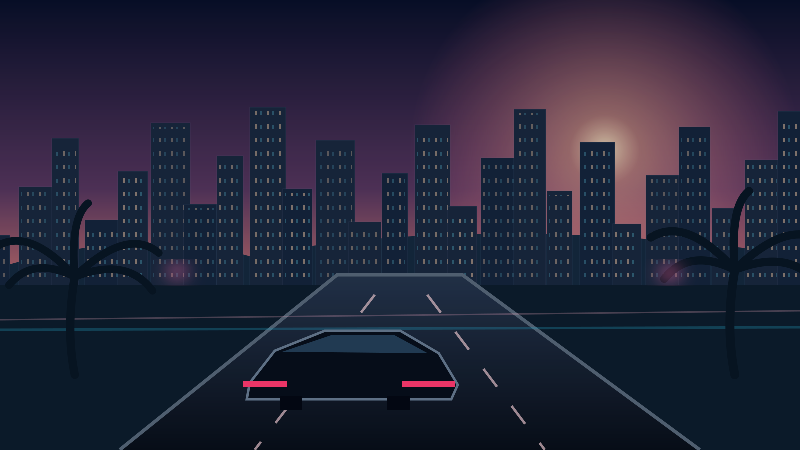
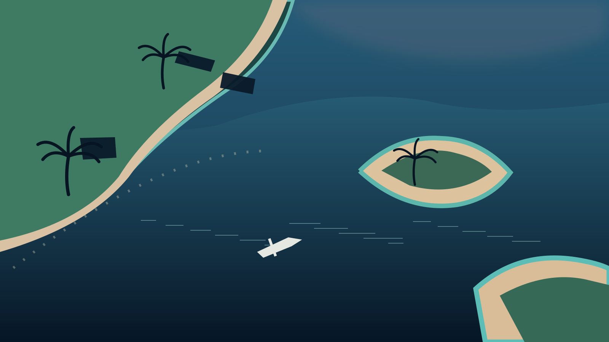
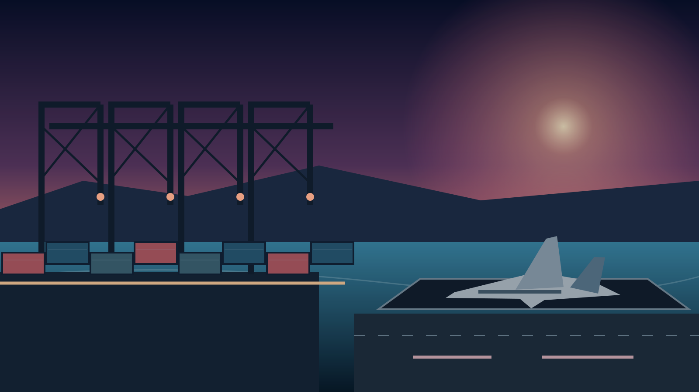

# GRAND COAST OUTLAWS — MEDIA & CONCEPT GALLERY

The gallery below contains **original illustrated project concept artworks**. These are **NOT screenshots from a running Unreal Engine build**. The work explores locations, atmosphere and presentation for Grand Coast Outlaws; it does not prove any game location, vehicle or mechanic is finished.

## Visual concepts in the public repository

### Downtown / after dark

A visual study of the imagined city's dense downtown, illuminated street corridors and late-night vehicle pursuits. **Type:** concept art.

### Islands / coastline

An aerial visual study of coastal terrain, shore roads, water routes and islands. **Type:** concept art.

### Harbor / airfield

An industrial waterfront, cargo infrastructure and aviation silhouette. **Type:** concept art.

### Initial skyline exploration

An earlier illustrated background exploring coastal skylines at dusk. **Type:** concept art.

## What is not published here

The project has discussed menu layouts, brand animation, panoramas and cinematic illustrations in development conversations. They are not presented here as verified screenshots or live gameplay. Publication of external render files requires an intentional selection, a transferable approved image file and a license/privacy check.

**Confirmed public in-engine screenshot gallery:** not yet published.  
**Public game build / downloadable demo:** not available.  
**Official gameplay trailer:** not announced.

## Media categories

| Type | What it means | Publication rule |
| --- | --- | --- |
| Concept art | Illustration, design exploration or previsualization | Must say `concept art` |
| UI concept | Proposed menu or HUD appearance | Must not imply every button or feature is implemented |
| In-engine prototype | Actual frame captured from a running UE build | Record capture date, build and prototype status |
| Development capture | Actual editor or test-session screen | Remove private debug data and identify WIP state |
| Gameplay demo | Actual recorded interaction with a running game | Describe test scope and known limitations |

## Before adding real images

Verify ownership and permitted distribution; check embedded metadata and visible private information; compress assets for web delivery; and preserve accurate labels. When real gameplay screenshots are ready, they will appear here in a separate section rather than replacing concept labels.

[Back to project overview](../README.md) · [Development status](DEVELOPMENT_STATUS.md)
