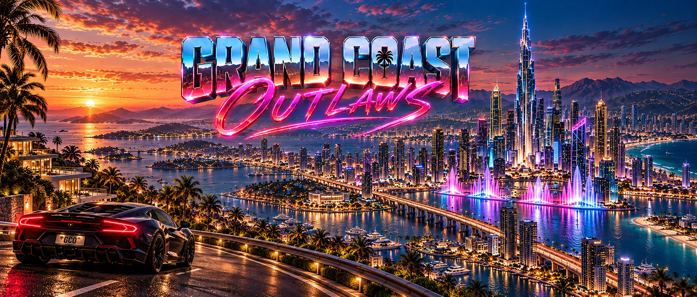

# GRAND COAST OUTLAWS — MEDIA STATUS

The newly added downtown, coastline, harbor and stylized B graphics were withdrawn from the public repository. They do not represent approved GCO visuals.

## Approved promotional cover art

This **1920 × 819 px** illustration was selected for the project's GitHub showcase on 23 October 2026. It represents the long-term visual direction of the planned world and is **concept art, not a screenshot of the game**.

**No verified in-engine screenshots have been published in this repository yet.** Additional gameplay captures will be published only after review.

## What is not published here

The project has discussed menu layouts, brand animation, panoramas and cinematic illustrations in development conversations. They are not presented here as verified screenshots or live gameplay. Publication of external render files requires an intentional selection, a transferable approved image file and a license/privacy check.

**Confirmed public in-engine screenshot gallery:** not yet published.  
**Public game build / downloadable demo:** not available.  
**Official gameplay trailer:** not announced.

## Media categories

| Type | What it means | Publication rule |
| --- | --- | --- |
| Concept art | Illustration, design exploration or previsualization | Must say `concept art` |
| UI concept | Proposed menu or HUD appearance | Must not imply every button or feature is implemented |
| In-engine prototype | Actual frame captured from a running UE build | Record capture date, build and prototype status |
| Development capture | Actual editor or test-session screen | Remove private debug data and identify WIP state |
| Gameplay demo | Actual recorded interaction with a running game | Describe test scope and known limitations |

## Before adding real images

Verify ownership and permitted distribution; check embedded metadata and visible private information; compress assets for web delivery; and preserve accurate labels. When real gameplay screenshots are ready, they will appear here in a separate section rather than replacing concept labels.

[Back to project overview](../README.md) · [Development status](DEVELOPMENT_STATUS.md)
